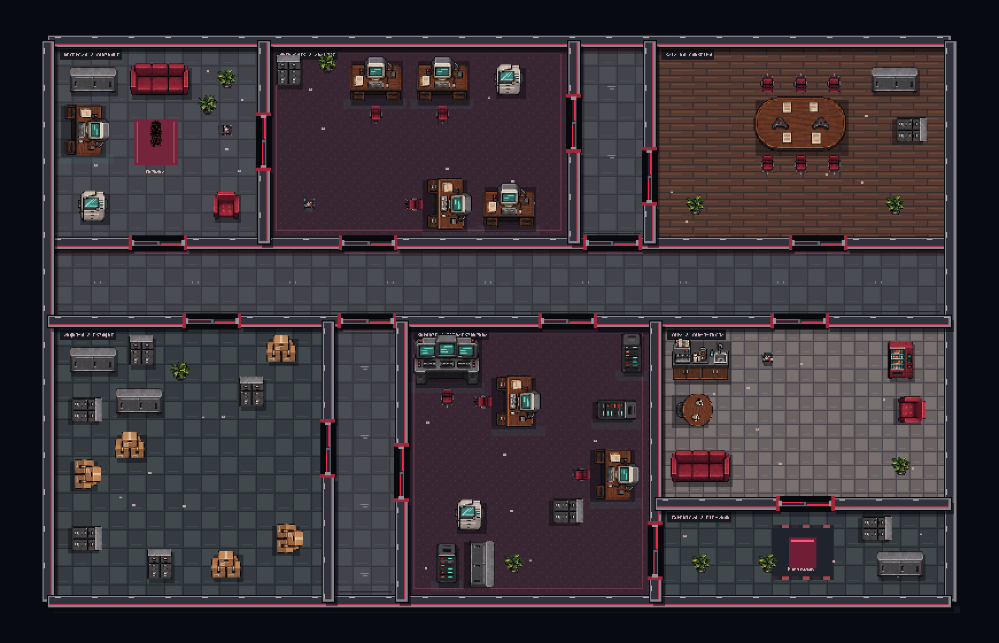

# Primeiro mapa: escritório corporativo

Este documento descreve o primeiro escritório implementado. Os modelos de
segurança, lazer e departamentos também estão disponíveis; veja
[os novos layouts](map-layouts.md).

O modelo participa da rotação no setor de escritórios, junto aos layouts de
segurança e departamentos. O Quiz, buffs, armas e elevadores continuam com suas
regras existentes.

## Planta e variação

São dez ambientes compartilhando paredes: recepção, operações, acesso executivo,
reunião, circulação principal, arquivo, acesso técnico, suporte, copa e elevador.
Dois ramais em posições desencontradas dividem o prédio em departamentos de
proporções distintas. A circulação principal tem 136 unidades de largura e
os ramais têm 128/132, para permitir manobra sem grandes áreas de corredor vazio.

A geração varia divisórias, larguras, portas, conexões opcionais, mobília e
espelha a planta. Um trajeto de 64 unidades de largura entre cada porta e o
ponto de circulação da sala fica reservado. Móveis também respeitam a área
de abertura das portas e as áreas de entrada e elevador.

Os 16 sprites incluem mesas, cadeiras, arquivo, sofá, plantas, servidores,
monitoramento, máquina de bebidas, café, caixas, armário baixo, mesa pequena,
lixeira, copiadora e poltrona. Móveis grandes entram na mesma lista de colisores
das paredes, portanto bloqueiam movimento, tiros e visão. Cadeiras e pequenos
objetos são decorativos e atravessáveis.

Guardas priorizam postos de acordo com o tipo: robôs junto à infraestrutura,
policiais nos corredores, atiradores na área executiva e outros nos departamentos.
As posições passam pelos testes de colisão, distância, separação e acessibilidade.
O comportamento de percepção e investigação existente é preservado.

## Renderização

O atlas é carregado junto aos sprites do jogador. Pisos, paredes, sinalização,
sombras e móveis são preparados em duas camadas raster de 870 × 560 por andar.
Durante o jogo essas camadas são desenhadas sem suavização. Portas, inimigos,
projéteis e efeitos permanecem dinâmicos.



A prévia é exportada a partir dos comandos do renderer real usando System.Drawing.
Ela serve para inspecionar a planta e os sprites; não é uma captura de navegador.
Seu texto pode diferir ligeiramente da fonte do canvas no navegador.

## Validação

- `node tests/office-content.cjs`: 100 plantas reproduzíveis diferentes,
  programas de mobiliário, colisores e recortes do atlas.
- `node tests/stealth-runtime.cjs`: mapas dos três setores, portas e percepção;
  mais 15 andares do escritório em três ciclos, travessia com folhas abertas,
  posições dos inimigos, renderização e os handlers reais do elevador,
  Quiz, escolha de buff e chegada ao setor seguinte.
- `node tests/quiz-runtime.cjs`: regressão das 30 perguntas e 60 respostas.

Os testes do jogo usam adaptações de DOM/canvas em Node. A revisão visual foi
feita pela prévia exportada; não substitui uma partida em navegador.

Para regenerar a prévia no Windows:

```powershell
node tests/export-office-preview.cjs
powershell -NoProfile -ExecutionPolicy Bypass -File tests/render-office-preview.ps1
```

## Arquivos desta etapa

- game.js e index.html: integração do gerador, atlas, postos e renderer.
- map-corporate.js: arquitetura, portas, circulação, mobília e postos.
- office-renderer.js: recortes do atlas e camadas estáticas.
- assets/maps/corporate-furniture.png e README.md: arte e prompt.
- tests/office-content.cjs e stealth-runtime.cjs: validação.
- tests/export-office-preview.cjs e render-office-preview.ps1: exportação.
- Esta documentação e corporate-office-preview.png.
