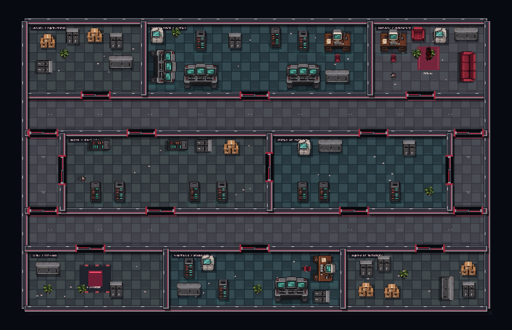
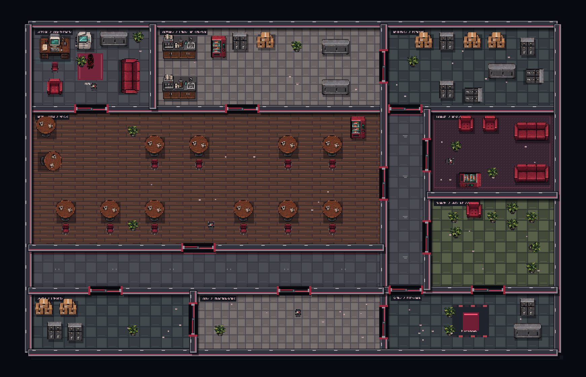
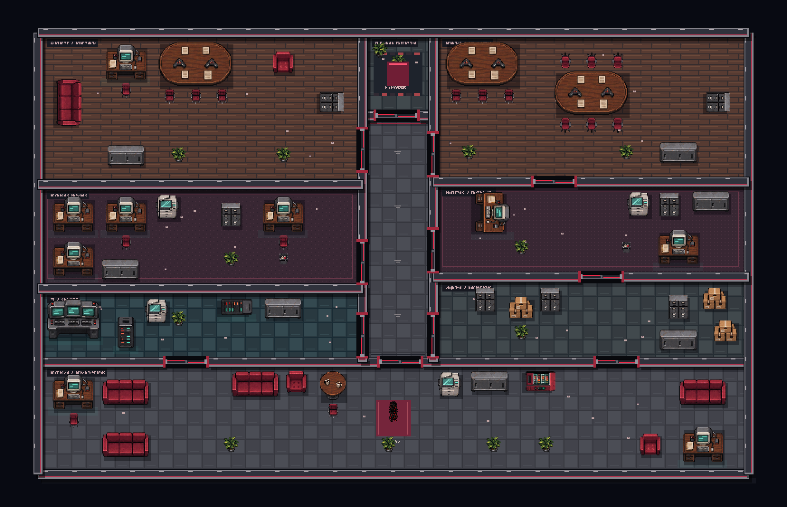

# Quatro modelos de mapa

Todos os modelos usam as mesmas portas interativas, percepção, navegação,
colisões e sprites de móveis. O gerador reserva a circulação antes de mobiliar.
Os andares passam a usar plantas compactas com paredes compartilhadas em todos
os setores; a antiga grade de salas permanece apenas como fallback no código.

| Modelo | Estrutura | Ambientes |
| --- | --- | --- |
| Corporativo | Circulação horizontal com dois ramais desencontrados; 10 salas | Recepção, operações, conselho, arquivo, TI e copa |
| Segurança | Anel completo com duas rotas laterais em volta do núcleo; 12 salas | Monitoramento, vigilância, servidores, armaria, arquivo e manutenção |
| Lazer | Refeitório amplo conectado à cozinha e a uma ala lateral; 11 salas | Cozinha, despensa, mesas em ilhas, lounge, jardim interno e copa |
| Departamentos | Eixo vertical com departamentos em ambos os lados; 9 salas | Recepção, financeiro, projetos, RH, gabinete, arquivo e TI |

As divisórias, portas, conexões opcionais, mobília e postos variam a cada geração.
As plantas podem ser espelhadas. Passagens estreitas usam o recolhimento de folhas
já existente quando não há espaço seguro para giro.

## Distribuição nos andares

No primeiro ciclo:

- Andares 1–5: corporativo, segurança, departamentos, corporativo, segurança.
- Andares 6–10: variações do mapa de lazer.
- Andares 11–15: departamentos e segurança alternados.

A rotação avança nos ciclos seguintes para variar os modelos encontrados no mesmo
setor. A quantidade e os atributos dos inimigos continuam seguindo as regras
existentes. O elevador continua exigindo a limpeza do andar e iniciando o Quiz.

## Prévias

Estas imagens foram exportadas dos comandos do renderer, sem inimigos.
Não são capturas de uma partida no navegador.

## Testes

- `node tests/layout-content.cjs`: 100 plantas de cada modelo, total de 400;
  tipos de mobília, colisores, cobertura da planta, limites, ausência de salas
  sobrepostas, conexões e distribuição dos modelos ao longo de 90 andares.
- `node tests/stealth-runtime.cjs`: 100 mapas no runtime real com DOM/canvas
  adaptados, portas e percepção; mais 27 andares em ciclos distintos, acesso
  com folhas abertas, inimigos válidos, renderização, interação com E nos quatro
  modelos e fluxo elevador → Quiz → buff → próximo setor.
- `node tests/door-regression.cjs`: abertura junto às dobradiças e portas
  obstruídas, preservando a correção do bloqueio de progressão.
- `node tests/quiz-runtime.cjs`: regressão das perguntas e respostas.

A avaliação visual usa as prévias exportadas. A validação de uma partida no
navegador continua necessária.

Arquivos principais: map-layouts.js (modelos e rotação), map-corporate.js
(montagem compartilhada e mobília), office-renderer.js (materiais), game.js
(seleção), index.html (carregamento), testes e esta documentação.
